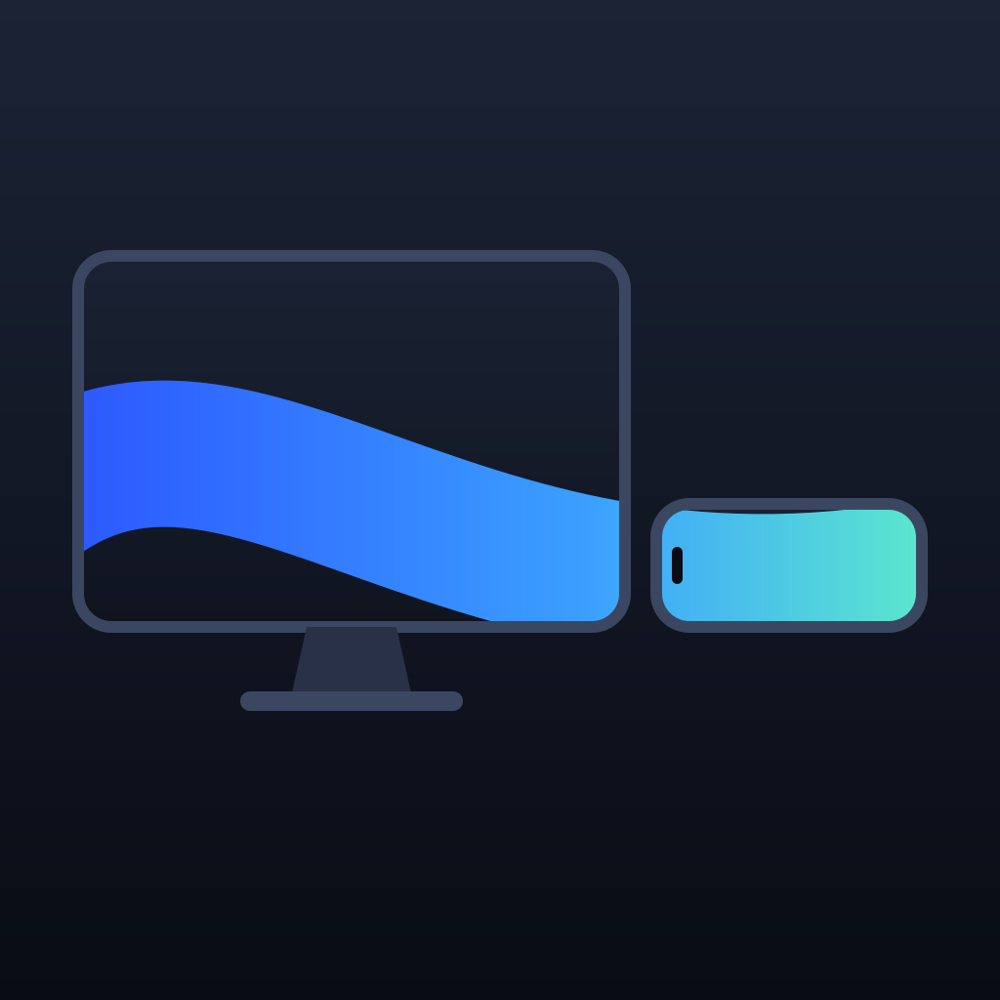
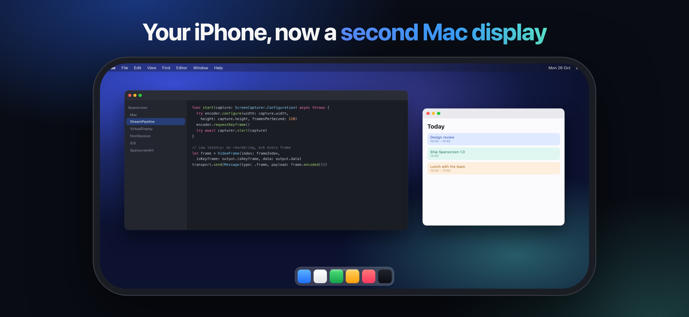
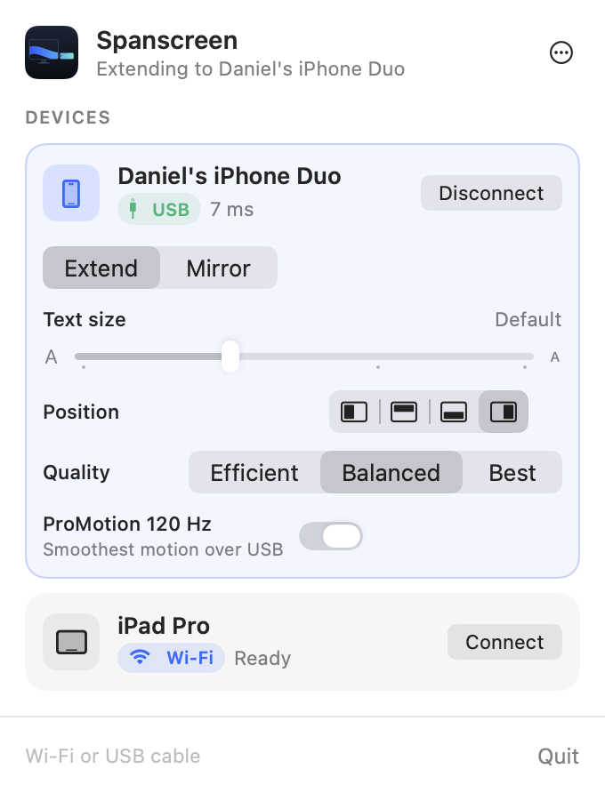

<p align="center">
  
</p>

<h1 align="center">Spanscreen</h1>

<p align="center">
  Use your iPhone as a second display for your Mac. Extend or mirror over Wi-Fi or a USB cable.<br>
  Built for iPhone Duo, works on every iPhone and iPad. Free and open source.
</p>

<p align="center">
  <a href="https://apps.apple.com/app/id6827203170">App Store</a> ·
  <a href="https://github.com/codextde/spanscreen/releases/latest/download/Spanscreen.dmg">Download for Mac</a> ·
  <a href="https://codextde.github.io/spanscreen/">Website</a>
</p>

<p align="center">
  
</p>

<p align="center">
  
</p>

---

## Features

- **Extend or mirror.** Spanscreen adds a real display to macOS. Arrange it in System Settings like any monitor, or mirror your main screen.
- **Retina sharp.** The virtual display matches the iPhone's pixels one to one. Pick Larger, Default, More Space or Most Space.
- **Wi-Fi, peer-to-peer or cable.** Same network, no network at all (Apple Wireless Direct Link), or a USB cable for the lowest latency. Plug in while streaming over Wi-Fi and Spanscreen switches to the cable by itself.
- **Low latency.** Hardware HEVC encoding with low-latency rate control, hardware decoding and no buffering on either side. The Mac adapts the bitrate to the link and shows the measured latency.
- **ProMotion.** Up to 120 Hz on iPhones that support it.
- **Touch and trackpad.** Tap to click, hold to right-click, drag, two-finger scroll with momentum. Or switch to trackpad mode for precise pointer control. Hardware keyboards work too.
- **Made for iPhone Duo.** Fold or unfold and the Mac display follows: the cover screen and the large inner screen each get their own native resolution. Rotate to get a portrait display.
- **Private.** No account, no cloud, no tracking. The picture travels only over your local network or cable.

## How it works

| Mac (menu bar app) | iPhone / iPad |
| --- | --- |
| Creates a virtual display (`CGVirtualDisplay`) in the phone's resolution | Advertises itself over Bonjour (`_spanscreen._tcp`) and listens on TCP 47913 |
| Captures it with ScreenCaptureKit | Decodes with `AVSampleBufferDisplayLayer` and shows frames immediately |
| Encodes HEVC with VideoToolbox (low-latency rate control, no frame reordering) | Acknowledges every frame so the Mac can measure latency and back off |
| Streams over TCP, or over USB through `usbmuxd` | Sends touch, scroll and keyboard input back |
| Injects input with `CGEvent` | Reports fold, unfold and rotation so the Mac can resize the display |

The protocol lives in [`Packages/SpanscreenKit`](Packages/SpanscreenKit) and is shared by both apps.

## Requirements

- Mac with macOS 14 Sonoma or later (Apple silicon or Intel with a hardware HEVC encoder)
- iPhone or iPad with iOS 17 or later

## Install

1. Download [Spanscreen for Mac](https://github.com/codextde/spanscreen/releases/latest/download/Spanscreen.dmg), drag it to Applications and open it. It lives in the menu bar.
2. Allow **Screen Recording** (to show the display on the iPhone) and **Accessibility** (to click with touch).
3. Install [Spanscreen for iPhone](https://apps.apple.com/app/id6827203170) and open it on the same Wi-Fi or connect the cable.
4. Choose your iPhone in the Mac menu bar, or tap your Mac on the iPhone. The first Wi-Fi connection asks for approval on the iPhone. After that, it connects by itself.

## Build from source

```sh
brew install xcodegen
xcodegen generate
open Spanscreen.xcodeproj
```

Run the `SpanscreenMac` scheme on your Mac and `SpanscreenIOS` on your iPhone. Protocol tests:

```sh
swift test --package-path Packages/SpanscreenKit
```

## Releases

Pushing a tag like `v1.0.1` runs [`release.yml`](.github/workflows/release.yml):

- **Mac**: archives with the Developer ID certificate, notarizes and staples the app and the DMG, and attaches `Spanscreen.dmg` to the GitHub release.
- **iOS**: archives with the App Store profile and uploads the build to App Store Connect.

Required repository secrets: `APPLE_TEAM_ID`, `MAC_CERTIFICATE_P12`, `MAC_CERTIFICATE_PASSWORD`, `IOS_CERTIFICATE_P12`, `IOS_CERTIFICATE_PASSWORD`, `IOS_PROVISIONING_PROFILE`, `ASC_KEY_ID`, `ASC_ISSUER_ID`, `ASC_KEY_P8`, `KEYCHAIN_PASSWORD`.

## License

MIT, see [LICENSE](LICENSE). Made by [Codext](https://codext.de).
